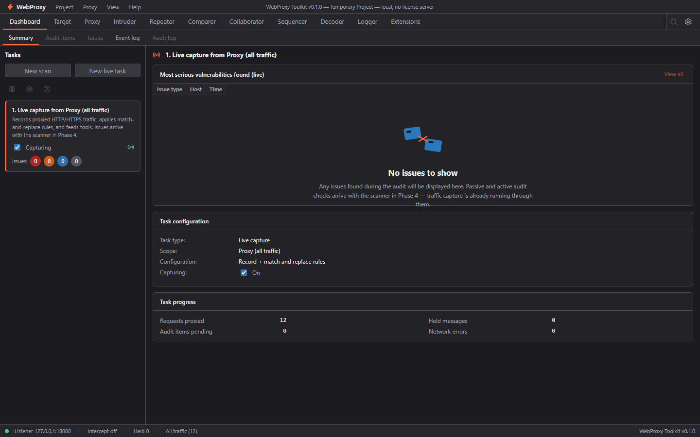
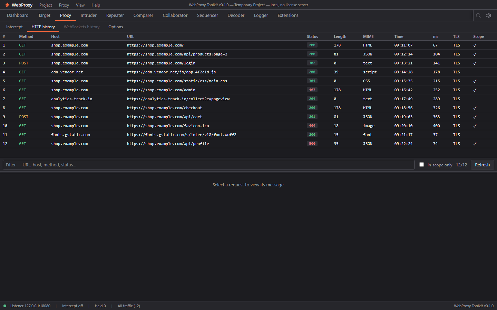

# WebProxy Toolkit

A Burp Suite–style web security workbench that runs entirely on your machine — no license server, no account, no telemetry. Clean-room implementation: original UI and code, built from observed behavior only.



## Status

| Phase | Feature | State |
|-------|---------|-------|
| 1 | App shell, Proxy (history / intercept / options), Target, Repeater, Decoder, Settings | done |
| 2a | Comparer, Sequencer, Logger (+ Dashboard event log) | done |
| 2b | WebSocket history, global search, Repeater per-tab history & follow-redirects, intercept Action menu | done |
| 3 | Intruder (attack engine, positions, payload sets, results) | done |
| 4 | Passive scanner, Issues view, active audit, crawling, scan configs | done |
| 6 | Extensions (embedded JS engine, Burp-like extension API) | done |
| 7 | Collaborator (local out-of-band interaction server) | planned |
| 8 | Session handling & macros, upstream proxy, TLS options, multi-listener, shortcuts | planned |

## Features

- **Proxy** — MITM HTTP/HTTPS proxy with a locally generated CA, HTTP history with detail panes (Pretty / Raw / Hex, find bar), request & response interception with an inline held-message editor, scope and match/replace rules, options.
- **Target** — site map with URL/HTTP-method views, crawl paths, in-scope filtering, issue list.
- **Repeater** — multi-tab request editor with parsed request inspector (line, headers, parameters, body), send/cancel, save/close.
- **Intruder** — attack engine with §…§ positions (auto-detect / wrap selection), 4 attack types (sniper, battering ram, pitchfork, cluster bomb), up to 8 payload sets (simple list / numbers) with 14 payload processors (url/base64 encode+decode, md5/sha1/sha256, replace, prefix/suffix, upper/lower, trim, reverse), threads/delay/max-request resource pool, live results with payload combos, status codes, grep extractors and full request/response inspection.
- **Comparer** — side-by-side line and word diffs of any two messages, differences table with prev/next navigation.
- **Sequencer** — token randomness analysis: sampling from a live URL (cookie / header / regex) or pasted samples, entropy, chi-square uniformity, Monte Carlo π, byte-level per-position stats.
- **Logger** — persistent event log (proxy, repeater, scope, scanner, system) with tool/level/text filters, also embedded in the Dashboard (Audit log tab filters to scanner).
- **Decoder** — encode/decode transforms (URL, Base64, hex, …).
- **Scanner** — passive checks on every in-scope response (17 header/cookie/banner/info-leak checks), active audit engine that crawls a target and tests parameters (SQL injection, reflected XSS, path traversal, open redirect, sensitive files), issue framework with dedupe/severity/confidence, issue detail with linked exchange, named scan configs (limits, threads, throttle, enabled checks) with an issue-definitions catalog, and Dashboard scan tasks with live progress + pause/resume/cancel.
- **Extensions** — embedded QuickJS engine with our own `wpt` JavaScript API: proxy listeners, HTTP handlers (request/response rewriting in the relay), context-menu actions in Proxy and Repeater, and custom report tabs rendered in sandboxed iframes; per-extension error latch (disable after 5 consecutive failures) with an error console in the Extensions panel.
- **Dashboard** — project summary, scan tasks (crawl/audit) with live progress, issues with severity counts, event log, scanner audit log.
- **A11y & theme** — full keyboard navigation, ARIA roles, WCAG AA contrast, dark Burp-like theme, responsive down to ~1000 px.



## Architecture

```
app/
  src/            React + TypeScript UI (Vite)
    components/   shell pieces: tabs, menus, message viewer, error boundary
    panels/       one file per tool tab
    lib/          pure logic: diff, entropy/analysis
  src-tauri/      Rust backend (Tauri 2)
    ca.rs         local CA generation (rcgen/rustls)
    proxy.rs      MITM proxy: listeners, TLS, intercept, relay
    db.rs         SQLite persistence (project file, history, logs)
    commands.rs   Tauri command surface (the only UI ↔ backend API)
tests/e2e.rs      end-to-end proxy tests (own CA per test run)
qa/               Playwright harness: Tauri IPC mock + screenshots
replica/          parity inventory (features.csv), design tokens, recon notes
```

- Project data lives in `%LOCALAPPDATA%\WebProxyToolkit\` (`project.wpt`, `ca.crt`, `ca.key`, body blobs).
- The UI talks to Rust only through `#[tauri::command]` handlers registered in `lib.rs`.

## Getting started

Prerequisites: Node.js ≥ 20, Rust (stable), the Tauri 2 [prerequisites](https://v2.tauri.app/start/prerequisites/) for your OS.

```powershell
cd app
npm install
npm run tauri dev        # opens the desktop app; UI at http://localhost:1420
```

Other scripts: `npm run build` (strict `tsc` + Vite), `cargo test` (in `app/src-tauri`).

For browser-driven testing, start the backend with `WEBPROXY_AUTOSTART=18080` to auto-start the proxy listener on the given port.

### QA harness

```powershell
python qa\shot.py        # 38 screenshots against the dev server, fails on console errors
```

`qa/mock.js` shims the Tauri IPC so the UI runs in a plain browser; `window.__SCENARIO__` switches fixtures (held request, stopped listener, …). Screenshots land in `qa/shots/` (gitignored).

## Scope & limitations

- Local-only: no license validation, no cloud, no Burp compatibility claims.
- Clean-room: no PortSwigger code, assets, or copied text; icons are Lucide, font is Inter.
- For authorized testing of systems you own or have permission to test.

## Repository

Private: https://github.com/jojin1709/webproxy-toolkit
